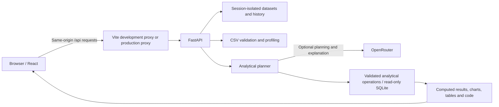

# DataPilot AI

A CSV analytics workspace built with React and FastAPI. Upload a dataset, inspect its quality, ask questions, and review the calculations behind the answers.

DataPilot combines deterministic data processing with optional OpenRouter-assisted query planning and explanations. You can use dataset previews, SQL queries, profiling, and anomaly detection without an AI API key.

> **Project status:** local development version. The frontend has been reported working by the project owner. A complete automated test suite, production security review, and end-to-end deployment verification are still outstanding. This README describes the latest frontend and backend supplied for this project; earlier copies may differ.

## What you can do

- Upload one or multiple UTF-8 CSV files.
- Switch between datasets within the current browser session.
- Inspect previews, inferred types, missing cells, duplicate records, and profiling warnings.
- Ask supported analytical questions using the local planner, or configure OpenRouter for AI-assisted planning.
- View computed results as bar charts, line charts, or tables in the latest self-contained frontend.
- Inspect the SQL query and the corresponding Pandas/SQLite workflow.
- Run read-only SQLite queries against the active dataset.
- Detect numeric anomalies with IQR, Z-score, or Isolation Forest.
- Join datasets using selected keys and join types.
- Save analyses to a dashboard for the active session.
- Export analysis results as CSV, reports as Markdown, and code as text.

Not every natural-language request is supported. A configured AI model does not remove the analytical engine's constraints. Review results, assumptions, warnings, and generated SQL before using an answer for a business decision.

## Technology

| Layer | Technology |
| --- | --- |
| Frontend | React, TypeScript, Vite |
| Styling | Custom CSS in the latest frontend |
| Icons | Lucide React |
| Charts | Recharts |
| Backend | Python, FastAPI, Uvicorn |
| Data processing | Pandas, NumPy |
| SQL | SQLite |
| Anomaly detection | Statistical rules and scikit-learn |
| Optional AI provider | OpenRouter |
| Session storage | In-memory Python objects |

## How it works



The backend performs calculations on the uploaded data. When configured, the AI service helps create a structured plan and explain computed results; it does not replace execution of the calculation. If the provider fails, supported questions may fall back to the local planner with a warning.

## Project structure

```text
datapilot/
├── README.md
├── .gitignore
├── netlify.toml                 # Add if deploying the frontend to Netlify
├── backend/
│   ├── .env                    # Private local configuration; never commit
│   ├── .env.example            # Placeholder values only
│   ├── requirements.txt
│   └── app/
│       ├── main.py             # API routes and request schemas
│       ├── core.py             # Session management and limits
│       ├── ai/
│       │   └── client.py       # OpenRouter requests
│       ├── security/
│       │   └── sql.py          # Read-only SQLite execution
│       └── services/
│           ├── data.py         # CSV ingestion and profiling
│           └── analysis.py     # Planning, calculations and anomalies
├── frontend/
│   ├── index.html
│   ├── package.json
│   ├── package-lock.json
│   ├── tsconfig.json
│   ├── vite.config.ts
│   └── src/
│       ├── main.tsx
│       ├── App.tsx
│       ├── styles.css
│       ├── api.ts              # Optional helper from the earlier modular version
│       └── components.tsx      # Optional components from the earlier version
└── samples/
    ├── synthetic_sales.csv
    └── synthetic_customers.csv
```

The latest self-contained `App.tsx` includes its own API helpers and components. It does not require the older `api.ts` or `components.tsx` files. If you keep the API helper, `.ts` is the appropriate extension because it contains no JSX.

## 1. Install the prerequisites

Install:

- Python 3.11 or newer; the local Windows setup uses Python 3.11.
- Node.js 22 LTS and npm.
- VS Code or another editor.
- Git, if you plan to publish the source or deploy from a repository.

Check your installation in a terminal:

```powershell
python --version
node --version
npm --version
```

## 2. Open the project

Open the `datapilot` folder in VS Code using **File → Open Folder**.

The Windows examples below use:

```text
D:\projs\datapilot
```

Replace this path if your project is stored elsewhere.

## 3. Set up the backend

Open **Terminal → New Terminal**, choose PowerShell, and run:

```powershell
cd D:\projs\datapilot\backend
python -m venv .venv
Set-ExecutionPolicy -Scope Process -ExecutionPolicy RemoteSigned
.\.venv\Scripts\Activate.ps1
python -m pip install -r requirements.txt
```

You only need to create the virtual environment once. The execution-policy setting applies to this terminal process, not your permanent system configuration.

For macOS or Linux, use:

```bash
cd /path/to/datapilot/backend
python3 -m venv .venv
source .venv/bin/activate
python -m pip install -r requirements.txt
```

## 4. Configure the environment

Create `backend/.env`:

```dotenv
OPENROUTER_API_KEY=
OPENROUTER_MODEL=google/gemini-3-flash-preview
OPENROUTER_BASE_URL=https://openrouter.ai/api/v1

MAX_UPLOAD_MB=20
MAX_ROWS=100000
SESSION_TTL_SECONDS=7200
COOKIE_SECURE=false
```

Leave `OPENROUTER_API_KEY` empty to start without AI integration. Do not put a fake placeholder in that field if you want the backend to treat AI as unconfigured.

To enable AI:

1. Sign in at https://openrouter.ai/keys.
2. Create a private API key.
3. Confirm the exact model ID at https://openrouter.ai/models.
4. Check model availability, account credits, and pricing.
5. Paste the key into your local `.env` file.

The Gemini model ID above is the project's selected configuration, not a guarantee of ongoing provider availability. Change it to an available OpenRouter model if necessary.

### Configuration reference

| Variable | Purpose |
| --- | --- |
| `OPENROUTER_API_KEY` | Server-side provider credential; optional for local tools |
| `OPENROUTER_MODEL` | Exact model ID; code defaults to `openai/gpt-4o-mini` if unset |
| `OPENROUTER_BASE_URL` | Provider API base URL |
| `MAX_UPLOAD_MB` | Maximum size of each uploaded file; default 20 MB |
| `MAX_ROWS` | Row limit used by ingestion and join checks; default 100,000 |
| `SESSION_TTL_SECONDS` | Idle session lifetime; default 7,200 seconds |
| `COOKIE_SECURE` | Use `false` for local HTTP and `true` for deployed HTTPS |

The app reads environment variables. The startup command's `--env-file .env` flag loads the local file. Existing terminal environment variables take precedence, so open a fresh terminal if an old model or key keeps being used.

## 5. Start the backend

In the activated backend terminal:

```powershell
python -m uvicorn app.main:app --host 127.0.0.1 --port 8000 --env-file .env
```

Wait for:

```text
Application startup complete.
```

Check these URLs:

- Health: http://127.0.0.1:8000/api/health
- Interactive API documentation: http://127.0.0.1:8000/docs

Keep this terminal running.

A `404 Not Found` at `http://127.0.0.1:8000/` is expected: the backend has no homepage route. A favicon request returning 404 is also harmless.

## 6. Install and start the frontend

Open a **second terminal**:

```powershell
cd D:\projs\datapilot\frontend
npm install
npm run build
```

If the build succeeds:

```powershell
npm run dev
```

Open:

**http://localhost:5173/**

Keep both terminals running. The Vite development proxy forwards frontend requests from `/api` to the backend at `http://127.0.0.1:8000`.

The frontend must have `src/App.tsx` and `src/styles.css`, and `src/main.tsx` must import them. Do not mix stylesheets from different frontend versions.

## 7. Everyday startup

Once dependencies are installed, you do not need to reinstall them every time.

### Terminal 1 — backend

```powershell
cd D:\projs\datapilot\backend
Set-ExecutionPolicy -Scope Process -ExecutionPolicy RemoteSigned
.\.venv\Scripts\Activate.ps1
python -m uvicorn app.main:app --host 127.0.0.1 --port 8000 --env-file .env
```

### Terminal 2 — frontend

```powershell
cd D:\projs\datapilot\frontend
npm run dev
```

Visit http://localhost:5173/. Press **Ctrl+C** in each terminal when you want to stop the services.

For backend auto-reload during development, add `--reload`. Reloads restart the process and erase its in-memory sessions.

## 8. Try the application

### Load data

Click **Explore sample data**, or upload your own CSV. The sample button requires both files in the repository's `samples/` directory.

The synthetic sales data includes dates, customer identifiers, regions, products, quantities, revenue, and marketing spend. A few unusually large orders were deliberately added to demonstrate anomaly detection. These are demonstration records, not real business results.

### Inspect data quality

Open **Data Sources** and review:

- The first 100 records.
- Column names and inferred types.
- Missing cells and duplicate rows.
- Warnings about formatting or invalid dates.

Do not assume profiling has corrected your source data. Some numeric formatting may be normalized in the analytical copy, while warnings explain relevant changes or limitations.

### Ask a question

Select the sales dataset and open **AI Analyst**. Try:

```text
Compare revenue by region
Show monthly sales trends
Who are the top five customers?
What is the average revenue?
```

Inspect the result, chart, SQL, and warnings. The local planner is rule-based and can misinterpret ambiguous questions. OpenRouter planning is also constrained to the operations supported by the backend.

### Run SQL

Open **SQL Playground**. The active dataset is exposed as the SQLite table `data`:

```sql
SELECT region, SUM(revenue) AS total_revenue
FROM data
GROUP BY region
ORDER BY total_revenue DESC;
```

Only read-only queries are allowed. Returned results are capped at 500 rows.

### Detect anomalies

Open **Anomaly Detection**, choose numeric columns and a method, then run detection.

- IQR uses bounds based on 1.5 times the interquartile range.
- Z-score uses bounds based on three standard deviations.
- Isolation Forest uses a multivariate model; the backend requires suitable numeric data and at least 10 records.

An outlier is a statistical signal, not proof of fraud, an error, or a business problem. Review the evidence alongside the original context.

### Join files

In **Data Sources**, choose a second dataset, the left and right keys, and a join type. For the synthetic files, use `customer_id` on both sides.

The backend checks key types and limits estimated join size. Pandas merge semantics apply, including possible matches between null keys. Overlapping columns receive suffixes.

### Save and export

Choose **Save to dashboard** on an analysis to retain it during the active session. Export CSV, Markdown, SQL, or Pandas code when you need a lasting copy.

Saving to a dashboard is not permanent storage.

## Session and data limits

- Datasets and history are stored in backend memory, not a durable database.
- Each browser session receives a cookie identifying its workspace.
- Sessions expire after the configured idle lifetime.
- Backend restarts, deployments, and process reloads erase session data.
- The backend currently limits each session to 10 datasets.
- CSV ingestion limits files to 100 columns and the configured row/file size caps.
- Preview and frontend table displays are limited; they do not show every uploaded record at once.
- Use one backend worker and one instance until shared session storage is implemented.
- Frontend navigation is local React state; the latest frontend does not implement URL-based page routing.

## API overview

Use `/docs` on the running backend for request schemas and interactive documentation.

| Method | Endpoint | Purpose |
| --- | --- | --- |
| GET | `/api/health` | Service status and nonsecret configuration |
| GET | `/api/datasets` | List session datasets |
| POST | `/api/datasets/upload` | Upload CSV files using multipart form data |
| POST | `/api/datasets/sample` | Load the synthetic sample datasets |
| GET | `/api/datasets/{id}` | Dataset metadata |
| GET | `/api/datasets/{id}/preview` | Preview rows |
| GET | `/api/datasets/{id}/profile` | Data quality and schema profile |
| DELETE | `/api/datasets/{id}` | Remove a dataset from the session |
| POST | `/api/datasets/merge` | Join two session datasets |
| POST | `/api/analysis/query` | Analyze a natural-language question |
| POST | `/api/analysis/chart` | Execute an explicit analytical plan |
| POST | `/api/analysis/insights` | Statistical facts and review suggestions |
| POST | `/api/analysis/anomalies` | Detect numeric outliers |
| POST | `/api/analysis/sql` | Run read-only SQL |
| GET | `/api/sessions/current/history` | Current session history |
| GET | `/api/dashboards` | List saved analyses |
| POST | `/api/dashboards/{analysis_id}` | Save an analysis |
| POST | `/api/reports/export` | Download results or code |

Browser requests use the same origin via the frontend proxy. Standalone API clients must preserve the session cookie across requests.

## Validation and testing

### Frontend build check

```powershell
cd D:\projs\datapilot\frontend
npm run build
```

This checks TypeScript and creates a production bundle. It is not an end-to-end test.

### Manual smoke-test checklist

- [ ] Backend health endpoint returns success.
- [ ] Frontend loads without console or build errors.
- [ ] Sample data and a user-uploaded CSV can be loaded.
- [ ] Preview row and column counts match the input.
- [ ] A known aggregation matches a separately checked SQL result.
- [ ] Charts and tables represent the same result.
- [ ] Invalid CSV input returns a useful error.
- [ ] Read-only SQL succeeds and destructive SQL is rejected.
- [ ] Anomaly detection returns evidence and the correct method label.
- [ ] A compatible join creates a new dataset.
- [ ] Saved analyses and exports work.
- [ ] A separate private-browser session cannot access the first session's datasets.
- [ ] AI analysis works with a valid key, and failures are clearly surfaced.

Automated backend/frontend coverage has not been completed or verified for this project. The presence of Pytest or other test dependencies does not mean there is a passing test suite.

Run `npm audit` to review dependency findings. Do not run `npm audit fix --force` blindly: it can introduce breaking changes. Resolve findings and rerun the build and workflow checks before public deployment.

## Deployment: Render backend + Netlify frontend

This is a proposed deployment setup, not a verified live deployment. No live URL is included in this repository documentation.

### 1. Publish the source

Push the repository to your Git provider. Exclude `.env`, `.venv`, `node_modules`, private datasets, and credentials. Keep the sample files and frontend lockfile committed.

### 2. Deploy the backend on Render

Create a **Python Web Service** and connect the repository.

| Setting | Value |
| --- | --- |
| Root directory | Leave blank |
| Build command | `pip install -r backend/requirements.txt` |
| Start command | `uvicorn app.main:app --app-dir backend --host 0.0.0.0 --port $PORT --workers 1` |
| Instances | One |

Set environment variables in Render's dashboard, including the private provider key, model, base URL, and `COOKIE_SECURE=true`. Select a Python version compatible with your tested dependencies.

Leaving the root directory blank keeps the `samples/` directory accessible to the backend's existing sample loader.

After deployment, open the actual service URL with `/api/health` appended. A successful health response does not validate provider credentials; test a real AI analysis separately.

### 3. Configure Netlify

Create `netlify.toml` in the repository root:

```toml
[build]
  base = "frontend"
  command = "npm run build"
  publish = "dist"

[build.environment]
  NODE_VERSION = "22"

[[redirects]]
  from = "/api/*"
  to = "https://YOUR-BACKEND-HOST/api/:splat"
  status = 200
  force = true

[[redirects]]
  from = "/*"
  to = "/index.html"
  status = 200
```

Replace the placeholder with the actual backend hostname, commit the file, and import the repository into Netlify.

Vite's development proxy does not exist in the production bundle. The Netlify redirect supplies the production API proxy. Test cookie/session continuity, multiple uploads, and long-running AI requests through the deployed frontend. Hosting and proxy limits may be stricter than the application's limits.

### Before allowing public access

The current app has no login system, account authorization, or comprehensive request rate limiting. Anyone who can reach its analysis endpoint may consume provider credits. Add access control and rate limiting, review dependency vulnerabilities, and test resource exhaustion scenarios before public use.

For multiple workers or instances, replace in-memory state with shared storage and define a data-retention policy.

### Docker status

Docker configuration was discussed separately but has not been verified as part of the working project. Do not assume `docker compose up` is available unless the Dockerfiles and Compose configuration have actually been added and tested.

## Security and privacy

- Keep all API keys on the backend.
- Never use a `VITE_` environment variable for secrets; frontend values are public.
- Revoke any key exposed in chat, logs, screenshots, or repository history.
- `.gitignore` does not remove secrets that were already committed.
- Use HTTPS and secure cookies in production.
- Session isolation is not a substitute for authenticated user access control.
- SQL uses a controlled in-memory database with read-only authorization and a query deadline. This is not a complete operating-system resource sandbox.
- The backend does not execute arbitrary model-generated Python with `eval` or unrestricted `exec`.
- When AI is enabled, schema, questions, selected conversation context, and computed result values can be sent to OpenRouter and its model provider. Review their terms before uploading sensitive data.
- The server retains uploaded datasets in process memory during the session. Do not describe this as encrypted durable storage or guaranteed secure deletion.

## Troubleshooting

### `GET / 404 Not Found`

Expected on the backend root URL. Use `/api/health`, `/docs`, or the frontend at http://localhost:5173/.

### `Cannot find module './App'`

Confirm `frontend/src/App.tsx` exists with that exact name. Make sure it is not saved as `App.tsx.txt` or placed outside `src`.

### Missing styles or sidebar overlap

Use a matching `App.tsx` and `styles.css` version. `main.tsx` should import the intended stylesheet only. Remove old `App.css` or `index.css` imports that conflict with it.

### Frontend cannot reach the API

Keep the backend running on port 8000. Confirm `vite.config.ts` proxies `/api` to `http://127.0.0.1:8000`. On Netlify, configure the production redirect instead.

### AI key shows as configured, but chat fails

The health check only tests whether a nonempty key is present. Check model availability, credentials, provider credits, quotas, and response warnings. Do not share your key when asking for help.

### `.env` changes do not take effect

Restart the backend with `--env-file .env`. Open a fresh terminal if older environment variables override the file.

### Uploaded data disappears

The backend restarted, the session expired, or the browser's session cookie changed. Reload the data. Use one consistent frontend hostname and one backend process.

### Session problems on local HTTP

Set `COOKIE_SECURE=false` locally. Use `true` only for your HTTPS deployment.

### Sample data does not load

Confirm both synthetic CSV files are present in the repository-root `samples/` folder. Inspect the backend log without exposing private data or secrets.

### The server prints `Shutting down`

The process received a stop signal. A normal shutdown log is not itself a crash, and a request returning 404 does not cause shutdown. Check whether Ctrl+C, the terminal, a task runner, or the hosting platform stopped it.

## Known limitations

- Production authentication, rate limiting, and a full security review remain unfinished.
- No persistent dataset storage, durable dashboards, or shared session database.
- Local natural-language planning is limited and may misinterpret ambiguous metrics or follow-ups.
- AI-generated explanations can be inaccurate even when the underlying computation succeeds.
- Conversation context is bounded and basic, not comprehensive conversational memory.
- The latest self-contained UI offers bar/line charts and tables; other requested chart types are not implemented there.
- Insights are primarily descriptive statistics and general review recommendations, not a complete business intelligence engine.
- SQL and anomaly results are capped; frontend tables show only the first 100 matching returned records.
- The displayed Pandas workflow uses SQLite via Pandas to preserve executed-query semantics; it is not always a native `groupby` expression.
- No verified PDF export, deployment URL, screenshot collection, demo video, or comprehensive automated test suite is included.

 API keys, and `.env` files out of the recording. Add real screenshots and a video link only after recording the running application.
